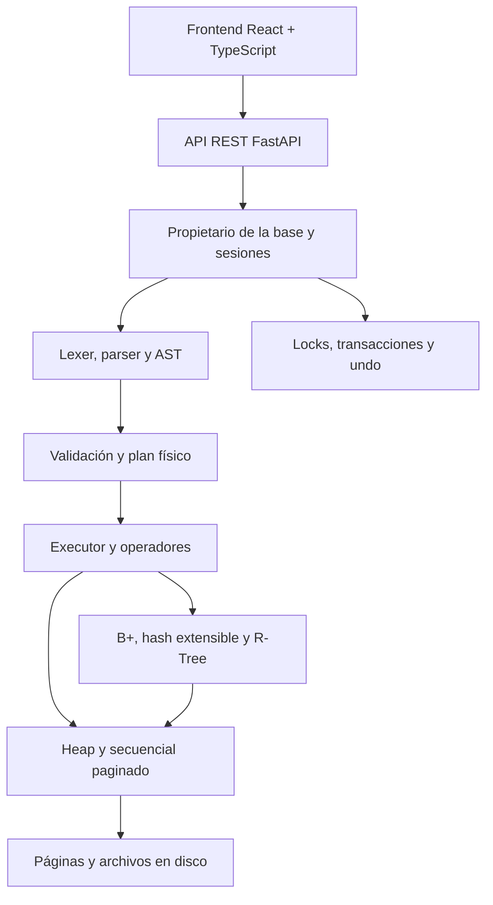

# MINI-DBMS — Minigestor de Base de Datos Multimodal

Proyecto de **Base de Datos 2, ciclo 2026-2**. Implementa un motor de base de
datos desde sus páginas y registros hasta la ejecución de SQL y la visualización
de sus resultados. Incluye tablas relacionales, datos espaciales, búsqueda
textual y búsqueda multimedia (imágenes y audio) integradas con SQL, API e
interfaz.

El almacenamiento, los índices, el parser, los operadores y las transacciones
son implementaciones propias. React y FastAPI proporcionan la interfaz y el
transporte HTTP. PostgreSQL/PostGIS se utiliza únicamente como comparador en
los experimentos.

## Funcionalidades

| Módulo | Implementación |
|---|---|
| Almacenamiento | Páginas de 4 KiB, registros tipados y RID; Heap con reutilización de espacio; archivo secuencial paginado con inserción ordenada, borrado lazy y reorganización |
| Índices relacionales | B+ agrupado, B+ no agrupado y hash extensible, con persistencia y mantenimiento de índices |
| Procesamiento SQL | Lexer y parser escritos a mano; validación semántica, planificación y ejecución de un subconjunto de SQL |
| Algoritmos externos | Ordenamiento mediante k-way merge, agrupación por hash externo y joins mediante Grace Hash, Nested Loop o índices elegibles |
| Transacciones | Sesiones independientes, BEGIN TRANSACTION, END TRANSACTION, ROLLBACK, locks compartidos/exclusivos, cancelación y undo físico |
| Datos espaciales | R-Tree propio para puntos 2D, consultas por radio, k-NN y polígonos; distancias Haversine y Euclidiana |
| Interfaz | Tablas y esquemas, editor SQL, resultados tabulares, planes reales y exploración espacial |
| Experimentos | Comparaciones de estructuras relacionales, de búsqueda secuencial/R-Tree/GiST, de TF-IDF/BM25 propios frente a PostgreSQL GIN y de IVF frente a HNSW (euclidiana y coseno), con 1 000, 10 000 y 100 000 registros, documentos o imágenes |
| Búsqueda textual | SPIMI persistente, TF-IDF/coseno y BM25 propios; MATCH/USING/SCORE en el motor SQL nativo, Heap sellado, preparación offline, API y paneles con scores/planes reales |
| Búsqueda multimedia | SIFT (imágenes) y MFCC (audio), vocabulario K-Means e histogramas TF-IDF; IVF y HNSW propios con métricas euclidiana, producto punto y coseno; SIMILAR_TO/SIMILARITY_SCORE en SQL, miniaturas y reproductor de audio en la interfaz |

## Demo completa en un solo puerto

Con Python 3.11 o superior y desde la raíz del proyecto:

```bash
python -m pip install -e ".[test,api,multimedia]"
python scripts/setup_all.py
python -m api --all --allow-writes
```

Abre `http://127.0.0.1:8000`. La interfaz tiene una pestaña por parte
(Relacional, Espacial, Texto, Multimedia y RAG académico), cada una con su
base y sus sesiones. `setup_all.py` prepara las cuatro bases de demostración
en `data/generated/todas/`, conserva los directorios existentes e indica el
comando de preparación manual si falta la Parte 5. `--allow-writes` solo
afecta a las Partes 1 y 2. Cada pestaña tiene dirección propia (`#parte3`),
y la API de cada parte vive en
`/parteN/api/...` (detalles en [api/unified.py](api/unified.py)).

Los modos individuales de las demos (`python -m api --text`, etc.) siguen
disponibles.

## Demo textual — bloques 4B y 5

```bash
python -m pip install -e ".[test,api]"
python scripts/setup_text.py
python -m api --text
```

Abrir `http://127.0.0.1:8000`. El paquete incluye el frontend compilado.
La preparación crea un destino nuevo; para repetirla, usar otro `--data-dir`.
La demo publica tres colecciones ([data/text_demo](data/text_demo/ATTRIBUTION.md)):
`documentos` (36 frases en español sobre el curso) y `articulos` (20 en
inglés), que son las tablas de los dos ejemplos del PDF, y `productos`, con
1 000 títulos reales de Amazon ESCI: el mismo subconjunto N = 1 000 del
experimento. Los ejemplos literales del PDF, el modo CSV, la arquitectura y la
secuencia de demo están en [PART_03/BLOQUE_4B_5.md](PART_03/BLOQUE_4B_5.md).
La comparación experimental con el corpus real (1 000/10 000/100 000
documentos y 30 consultas originales) está en
[docs/EXPERIMENTOS_TEXTO.md](docs/EXPERIMENTOS_TEXTO.md).

La Parte 3 está completa: corpus aceptado, SPIMI, TF-IDF/coseno, BM25,
sellado persistente, SQL nativo, API, interfaz y comparación con PostgreSQL.
Uso y límites en [docs/text.md](docs/text.md); cierre de las fases 6 y 7 en
[PART_03/BLOQUE_6_7.md](PART_03/BLOQUE_6_7.md).

## Demo multimedia — Parte 4

Requiere además el extra `multimedia` (numpy, OpenCV, soundfile y librosa):

```bash
python -m pip install -e ".[test,api,multimedia]"
python scripts/setup_multimedia.py --assets data/multimedia_demo
python -m api --multimedia
```

La demo incluye 120 fotos de COCO y 30 fragmentos de canciones de FMA con su
atribución ([data/multimedia_demo/ATTRIBUTION.md](data/multimedia_demo/ATTRIBUTION.md)).
En «Ejemplos SQL» están los dos ejemplos literales del enunciado:

```sql
SELECT * FROM imagenes WHERE SIMILAR_TO('foto_consulta.jpg', k=10)
USING HNSW WITH METRIC=cosine;

SELECT nombre, artista, SIMILARITY_SCORE() AS score FROM canciones
WHERE SIMILAR_TO('audio_query.mp3', k=5) USING IVF WITH METRIC=euclidean
ORDER BY score DESC;
```

Uso, API y reglas del SQL en [docs/multimedia.md](docs/multimedia.md);
contrato en [docs/multimedia-contract.md](docs/multimedia-contract.md);
experimentos con 100 000 imágenes en
[docs/EXPERIMENTOS_MULTIMEDIA.md](docs/EXPERIMENTOS_MULTIMEDIA.md); evidencia
por fase en `PART_04/BLOQUE_*.md`.

### Parte 5 — Preparación del corpus académico

Guarda los PDF indicados en [el manifiesto](PART_05/corpus.json) en
`data/generated/p5_inputs/` con los nombres registrados. Desde la raíz del
proyecto, con CPython 3.12, ejecuta:

```bash
python -X utf8 -m pip install -e ".[test,api,academic]"
python -X utf8 scripts/setup_academic.py --manifest PART_05/corpus.json --pdf-dir data/generated/p5_inputs --data-dir data/generated/todas/parte5
python -X utf8 scripts/setup_academic.py --verify-only --data-dir data/generated/todas/parte5
```

La preparación requiere un directorio de destino nuevo. Verifica los hashes
de los PDF y guarda `papers` y `chunks`, con un índice SPIMI para
`chunks.content`. Ejecuta `--verify-only` con el servidor detenido.
Las fuentes y los resultados de preparación están en la
[evidencia de la etapa 2](PART_05/STAGE_02_RESULTS.md).

Inicia el servidor unificado con `python -m api --all`. Desde otra terminal,
comprueba la recuperación REST de hasta tres pasajes con sus metadatos:

```bash
python -X utf8 scripts/check_academic_retrieval.py --base-url http://127.0.0.1:8000/parte5 --question "How does HNSW use a hierarchy of proximity graphs?"
```

La Parte 5 se monta en `/parte5` en modo de solo lectura. La
[evidencia de la etapa 3](PART_05/STAGE_03_RESULTS.md) incluye las preguntas
probadas, los pasajes y la verificación tras reiniciar el servidor.

### Parte 5 — Generación de respuestas con fuentes

Con el corpus preparado, instala el extra `rag` en el mismo entorno de Python.

```powershell
python -X utf8 -m pip install -e ".[api,academic,rag]"
```

Configura `OPENAI_API_KEY` en el `.env` privado de la raíz del proyecto.
`OPENAI_MODEL` es opcional y usa `gpt-6-luna` por defecto. Si defines
`P5_ENGINE_BASE_URL`, debe apuntar a `/parte5` en el mismo servidor y puerto.
El valor por defecto es `http://127.0.0.1:8000/parte5` con el puerto estándar.
Las variables del proceso tienen precedencia sobre el archivo. Mantén el
`.env` en tu equipo y reinicia el servidor tras cambiar la configuración.

```powershell
python -X utf8 -m api.academic_config
python -X utf8 -m api --all --data-dir data/generated/todas --host 127.0.0.1 --port 8000
```

El primer comando solo informa si hay una clave configurada. En otra terminal,
puedes probar el endpoint. Esta pregunta recupera evidencia y llama a OpenAI.

```powershell
$body = @{ question = "How does HNSW use a hierarchy of proximity graphs?" } | ConvertTo-Json
Invoke-RestMethod -Method Post -Uri "http://127.0.0.1:8000/parte5/api/rag/ask" `
  -ContentType "application/json" -Body $body -TimeoutSec 120 | ConvertTo-Json -Depth 10
```

El endpoint recupera hasta tres pasajes con BM25 y adjunta los textos y
metadatos usados para responder. Si la búsqueda no devuelve pasajes,
responde con `no_context` sin llamar al modelo. Consulta el
[contrato HTTP](PART_05/CONTRACT_P5.md#chat-application) y la
[evidencia de la etapa 4](PART_05/STAGE_04_RESULTS.md).

## Arquitectura



El frontend consume contratos HTTP; no modifica páginas ni ejecuta algoritmos
de consulta. El plan mostrado describe los operadores y accesos que usa el
motor. El propietario de cada base controla los archivos, el catálogo, las
sesiones y la coherencia de los índices.

| Directorio | Responsabilidad |
|---|---|
| `engine/catalog/` | Tipos, esquemas y metadatos |
| `engine/storage/` | Registros, páginas, RIDs, archivos Heap y secuenciales |
| `engine/indexes/` | B+ y hash extensible |
| `engine/operators/` | Scans, filtros, proyección, ordenamiento, agrupación y joins |
| `engine/query/` | SQL, AST, binding, planificación y ejecución |
| `engine/transactions/` | Sesiones, locks, cancelación y undo |
| `engine/spatial/` | Geometría, R-Tree, consultas y persistencia espacial |
| `engine/database/` | Propietario de bases con manifiesto persistente |
| `api/` | API REST y adaptación de la base de demostración |
| `frontend/` | Aplicación React, cliente HTTP y componentes |
| `benchmarks/` | Generadores, mediciones y gráficos |
| `tests/` y `demos/` | Pruebas y demostración de concurrencia |
| `scripts/` | Preparación de datos y comprobaciones de integración |
| `docs/` | Guías técnicas y resultados experimentales |

## Evaluación rápida con Docker Compose

Solo se necesita Docker. Desde la raíz del repositorio:

```bash
docker compose up --build
```

La primera vez tarda unos minutos: compila la interfaz y prepara las cuatro
bases dentro de la imagen (la multimedia extrae SIFT/MFCC y construye IVF y
HNSW). Luego abre **http://localhost:8000**: una pestaña por parte.

| Pestaña | Datos |
|---|---|
| Parte 1 · Relacional | `students`, `courses`, `enrollments` y sus versiones `_big`; escritura habilitada |
| Parte 2 · Espacial | `tiendas`, `restaurantes` y `lugares_lima` con mapa; escritura habilitada |
| Parte 3 · Texto | `documentos`, `articulos` y `productos` (1 000 títulos ESCI); colecciones selladas, solo lectura |
| Parte 4 · Multimedia | `imagenes` (120 fotos COCO) y `canciones` (30 clips FMA); solo lectura |

Un único proceso es dueño de los cuatro directorios de datos. Cada pestaña
tiene su propia sesión y sus **Ejemplos SQL**. `docker compose down` descarta
los cambios: el siguiente `up` empieza desde las bases originales.

## Instalación

Se necesita **Python 3.11 o superior**, **Node.js 20 o superior** y npm.
Ejecuta los comandos desde la raíz del repositorio. PostgreSQL no es necesario
para usar el motor, la API o la interfaz.

En Windows, desde PowerShell:

```powershell
python -m venv .venv
.\.venv\Scripts\python.exe -m pip install -e ".[test,api,bench,multimedia]"
cd frontend
npm ci
npm run build
cd ..
```

En Linux o macOS:

```bash
python3 -m venv .venv
.venv/bin/python -m pip install -e ".[test,api,bench,multimedia]"
cd frontend
npm ci
npm run build
cd ..
```

Los ejemplos siguientes utilizan `python` con el entorno virtual activado.
Si no lo activas, utiliza `.\.venv\Scripts\python.exe` en Windows o
`.venv/bin/python` en Linux/macOS.

## Ejecutar el proyecto

### Demostración relacional

Con el servidor detenido, prepara la base una sola vez:

```bash
python scripts/setup_demo.py
python -m api
```

Abre **<http://127.0.0.1:8000>**. La API sirve la interfaz compilada en
`frontend/dist`. Los datos se guardan en `data/generated/demo` y se reabren
en los siguientes arranques.

La muestra utiliza estudiantes, cursos e inscripciones. Incluye tablas
pequeñas con respuestas comprobables y tablas mayores para observar
ordenamiento, agrupación y joins externos.

### Demostración espacial

Detén el servidor anterior y prepara un directorio nuevo:

```bash
python scripts/setup_spatial.py
python -m api --spatial
```

Abre la misma dirección. Esta muestra contiene `tiendas` y `restaurantes`,
con columnas `id`, `nombre`, `latitud` y `longitud`, almacenadas en Heap.
Son puntos sintéticos locales; no representan un inventario comercial real.
El mapeo lógico `ubicacion` y los índices espaciales se reabren desde
`data/generated/spatial`.

`setup_spatial.py` exige un destino nuevo y no reemplaza una base existente.
Para preparar otra muestra, usa el mismo directorio en ambos comandos:

```bash
python scripts/setup_spatial.py --data-dir data/generated/spatial_nueva
python -m api --spatial --data-dir data/generated/spatial_nueva
```

### Crear tablas y consultar datos espaciales desde SQL

Con `--allow-writes`, la demo acepta `CREATE TABLE`, `CREATE INDEX`, `UPDATE`,
`DROP INDEX` y `DROP TABLE` (estos últimos comandos con las restricciones
indicadas en la [guía de extensiones SQL](docs/SQL_DDL_DML_EXTENSIONS.md)).
Tablas Heap con `id INTEGER`, `latitud FLOAT` y `longitud FLOAT` (sin columna
física `ubicacion`) aparecen automáticamente en el mapa. Consulta la
[demostración completa](docs/DEMO_SQL_ESPACIAL.md) para crear una tabla nueva,
insertar puntos, consultar radio/k-NN/polígono y comprobar rollback/reapertura.

### Escrituras y desarrollo

El servidor inicia en modo **solo lectura**. Para permitir inserciones,
borrados, creación de tablas e índices, actualizaciones y eliminación de tablas
SQL dinámicas desde la interfaz:

```bash
python -m api --allow-writes
```

Añade `--spatial` si utilizas la muestra espacial. El modo se muestra en la
interfaz y también se valida en el servidor. Detén el proceso con `Ctrl+C`.
Usa un único proceso por directorio de datos; no actives múltiples workers
ni recarga automática del backend.

Para desarrollar el frontend, deja la API en el puerto 8000 y abre otra terminal:

```bash
cd frontend
npm run dev
```

Vite sirve en **<http://127.0.0.1:5173>** y reenvía `/api` al backend.
Después de cambiar el frontend, ejecuta `npm run build` para actualizar la
versión servida por el puerto 8000.

## Usar la interfaz

1. Selecciona una tabla para consultar sus columnas, organización e índices.
2. Escribe SQL o carga una consulta de ejemplo. Ejecuta con el botón o con
   `Ctrl + Enter` (`Cmd + Enter` en macOS).
3. Revisa las filas y el plan de ejecución. Desactivar **Usar índices** cambia
   la estrategia enviada al motor y permite comparar sus accesos.
4. Utiliza **BEGIN**, **END** y **ROLLBACK** para agrupar, confirmar o deshacer
   operaciones. Cada pestaña tiene una sesión independiente; una recarga
   inicia otra sesión y no repite automáticamente las escrituras.
5. En la base espacial, selecciona una tabla y consulta por radio, vecinos
   cercanos o polígono. El mapa resalta los resultados devueltos por el motor.

El **Explorador espacial** utiliza Leaflet 1.9.4 con calles de OpenStreetMap
por HTTPS. Arrastra para desplazar, usa `+`/`−` para cambiar el zoom y haz clic
para elegir el centro. Con el mapa enfocado, las flechas desplazan y `Enter`
selecciona el centro visible. Los marcadores muestran nombre, ID y coordenadas;
los resultados del motor se resaltan en verde. Para un polígono, introduce un
par `latitud, longitud` por línea o activa el dibujo y marca sus vértices.
**Actualizar puntos** renueva la vista desde la base. **Ver puntos** ajusta
la vista a los registros recibidos. La cartografía requiere Internet; Leaflet
está incluido en la compilación y no requiere una clave de Google Maps.

Para una demo nueva con 20 lugares identificados del centro de Lima:

```bash
python scripts/setup_lima.py --data-dir data/generated/demo_lima
python -m api --spatial --allow-writes --data-dir data/generated/demo_lima
```

Ejecuta el preparador una sola vez, con el servidor detenido y en un directorio
nuevo. El CSV y su procedencia están en `data/lima/`. Consulta
[GUIA_LEAFLET_LIMA.md](GUIA_LEAFLET_LIMA.md) para instalación Windows y pruebas.

**Cargar consulta en SQL** envía al editor la búsqueda de radio o vecinos,
junto con `mi_ubicacion`. El parámetro se muestra debajo de los paneles y se
conserva para ese envío. Para cambiarlo, vuelve a cargar la consulta desde el
mapa. Los vértices del polígono se consultan mediante el contrato espacial
tipado; no se presenta una sintaxis SQL de polígonos que el motor no soporta.

Los resultados HTTP son una **vista limitada**, con un máximo de 500 filas y
un límite de bytes. La interfaz distingue resultados vacíos, completos,
limitados y errores. Un total desconocido no equivale al número de filas de
la vista. Los planes preparados y las mediciones de ejecución se presentan
con su alcance correspondiente.

## Consultas de ejemplo

Con la muestra relacional:

```sql
SELECT name FROM students WHERE age > 20 ORDER BY name;

SELECT career, COUNT(*) AS total
FROM students GROUP BY career ORDER BY career;

SELECT s.name, e.course
FROM students AS s JOIN enrollments AS e ON s.id = e.student_id
ORDER BY s.name, e.course;

EXPLAIN ANALYZE SELECT * FROM students WHERE id = 3;
```

Con la muestra espacial:

```sql
SELECT * FROM tiendas
WHERE distancia(ubicacion, POINT(-12.0464, -77.0428)) < 5000;

SELECT id, nombre,
       distancia(ubicacion, POINT(-12.0464, -77.0428), 'euclidean') AS metros
FROM tiendas ORDER BY metros LIMIT 10;
```

Las coordenadas de `POINT` y de las consultas HTTP se escriben en orden
**latitud, longitud**. Ambas distancias se expresan en **metros**. Haversine
es la opción predeterminada; Euclidiana usa una proyección local con origen
en `(-12.0464, -77.0428)`.

El dominio actual es latitud `[-12.30, -11.80]` y longitud
`[-77.25, -76.75]`. Los polígonos son simples, sin huecos, e incluyen el
borde. Los empates de vecinos se resuelven por distancia y luego por id.

La API admite el parámetro `mi_ubicacion` sin interpolar SQL:

```json
{
  "sql": "SELECT * FROM restaurantes ORDER BY distancia(ubicacion, mi_ubicacion) LIMIT 10",
  "parameters": {"mi_ubicacion": [-12.0464, -77.0428]},
  "use_indexes": true
}
```

## API REST

El servidor publica la referencia interactiva en
**<http://127.0.0.1:8000/docs>**.

| Ruta | Uso |
|---|---|
| `GET /api/health` | Estado, modo y límites |
| `GET /api/tables` | Tablas registradas |
| `GET /api/tables/{id}` | Esquema, organización e índices |
| `POST /api/query` | SQL, resultados, plan y mediciones |
| `POST /api/sessions` | Abrir una sesión |
| `GET /api/spatial/tables` | Mapeos, convenciones y tablas espaciales registradas |
| `POST /api/spatial/query` | Consultas tipadas de radio, k-NN o polígono |
| `GET /api/multimedia/tables` | Colecciones de imágenes/audio publicadas, índices y consultas registradas |
| `GET /api/multimedia/{tabla}/media/{archivo}` | Sirve solo archivos registrados de una colección |

Las peticiones de una sesión llevan `X-Session-Token`. El token identifica
una sesión del motor y permanece en memoria en la interfaz. Las consultas
espaciales usan los mismos locks y transacciones que el resto de la base.

## Experimentos y gráficos

Las mediciones conservan sus datos, configuración y versiones de código.
Los resultados relacionales de los tres tamaños y la repetición posterior
de 1 000/10 000 se documentan por separado para no mezclar entornos en una curva.

| Comparación | Resultados |
|---|---|
| Heap frente a secuencial; B+ agrupado/no agrupado frente a hash | [Método y conclusiones](docs/EXPERIMENTOS.md), [gráficos y tablas](docs/experimentos/resultados.md) |
| Repetición relacional de 1 000 y 10 000, cinco repeticiones | [Guía](docs/experimentos/README.md), [11 gráficos y resultados](docs/experimentos/actualizados_1k_10k/resultados.md) |
| Secuencial frente a R-Tree y PostgreSQL GiST | [Método y conclusiones](docs/EXPERIMENTOS_ESPACIALES.md), [radio](docs/figuras/spatial/radius.png), [k-NN](docs/figuras/spatial/knn.png), [recursos](docs/figuras/spatial/recursos.png), [memoria](docs/figuras/spatial/memoria.png) |
| TF-IDF/coseno y BM25 sobre SPIMI frente a PostgreSQL FTS + GIN + `ts_rank` | [Método y conclusiones](docs/EXPERIMENTOS_TEXTO.md), [construcción](docs/figuras/text/construccion.png), [consultas](docs/figuras/text/consultas.png), [relevancia](docs/figuras/text/relevancia.png), [disco y memoria](docs/figuras/text/recursos.png) |
| IVF frente a HNSW, euclidiana frente a coseno, k = 10, imágenes COCO | [Método y conclusiones](docs/EXPERIMENTOS_MULTIMEDIA.md), [construcción](docs/figuras/multimedia/construccion.png), [consultas](docs/figuras/multimedia/consultas.png), [Recall@10](docs/figuras/multimedia/recall.png), [memoria](docs/figuras/multimedia/memoria.png), [galería](docs/figuras/multimedia/galeria.png) |

La matriz espacial reúne 5 400 consultas medidas: tres tamaños, tres métodos,
radios de 1/5/10 km y k de 10/50/100, con 100 centros por configuración.
Los tiempos de cliente PostgreSQL incluyen su transporte y se distinguen de
los tiempos internos. Las cifras de memoria indican qué proceso se midió.

Para regenerar los gráficos espaciales desde los resultados conservados:

```bash
python -m benchmarks.spatial results --input benchmarks/results/spatial/2026-10-04 --output docs/figuras/spatial
```

La matriz textual reúne 810 consultas medidas: tres tamaños, tres métodos y
30 consultas originales de 1, 3 y 5+ palabras, con tres repeticiones. Antes de
medir se verifica que motor y PostgreSQL indexen los mismos lexemas y
encuentren los mismos documentos. Para regenerar sus tablas y gráficos:

```bash
python -m benchmarks.text.results --input benchmarks/results/text/2026-11-04 --output docs/figuras/text
```

La matriz multimedia reúne 1 080 búsquedas medidas: tres tamaños, IVF y HNSW
con euclidiana y coseno, 30 consultas y tres repeticiones, siempre contra la
búsqueda exacta sobre los mismos vectores. El corpus (unos 6 GB) se descarga
localmente; los resultados conservados regeneran tablas y gráficos (la galería
necesita además las imágenes descargadas):

```bash
python -m benchmarks.multimedia.results --input benchmarks/results/multimedia/2026-11-06 --output docs/figuras/multimedia
```

## Pruebas

Desde la raíz, con el entorno virtual activo:

```bash
python -m pytest -q -W error
python -m demos.transactions_demo
python scripts/integration_check.py --backend-only
python scripts/spatial_integration_check.py --data-dir data/generated/check_spatial --report data/generated/check_spatial.json
```

La demostración con hilos reproduce una actualización perdida, ejecuta la
versión protegida y la compara con una ejecución serial. Las comprobaciones
de integración levantan sus propios servidores y bases temporales.
La comprobación espacial exige un directorio de datos nuevo; usa otro nombre
en `--data-dir` si ya ejecutaste ese comando.

Para el frontend:

```bash
cd frontend
npm test
npm run typecheck
npm run build
```

## Alcance y documentación

Se implementa un subconjunto de SQL, no todo el estándar. El R-Tree se mantiene
en memoria y persiste un árbol validado; no es un índice espacial paginado.
Haversine utiliza una esfera y Euclidiana es una aproximación local. El límite
de filas HTTP acota la respuesta, no toda la memoria consumida por una consulta.

Las transacciones ofrecen rollback y coordinación dentro de un proceso.
No se implementan WAL, recuperación automática después de un crash, locks
entre procesos ni commit atómico de múltiples archivos ante pérdida de energía.

- [Guía del frontend](docs/frontend.md).
- [SQL y ejecución](docs/sql.md), [gramática](docs/sql-grammar.md).
- [Transacciones y concurrencia](docs/transactions.md).
- [Convenciones y consultas espaciales](docs/spatial.md).
- [Búsqueda textual](docs/text.md) y [búsqueda multimedia](docs/multimedia.md).
- [Configuración de despliegue](docs/despliegue.md).
- [Especificación del proyecto](Proyecto_Final.pdf).
