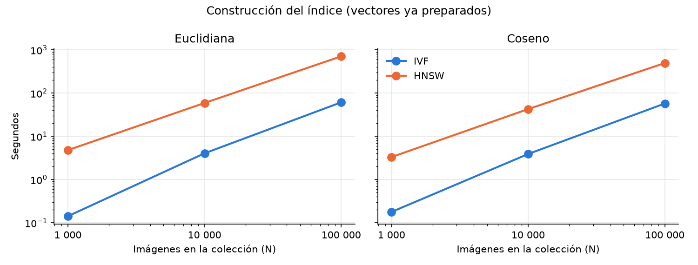
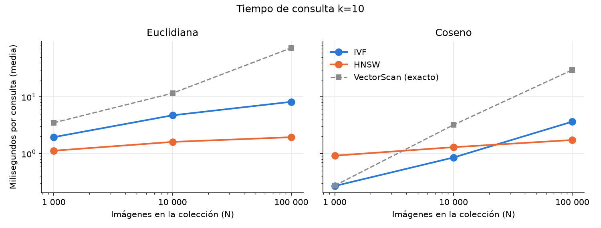
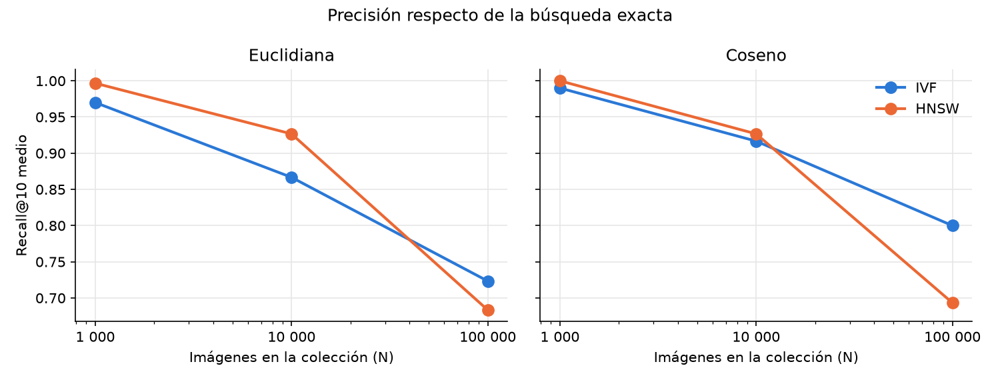
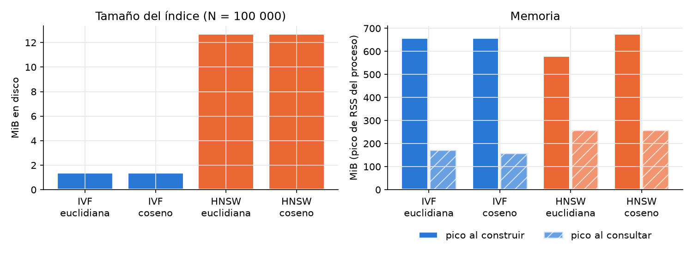
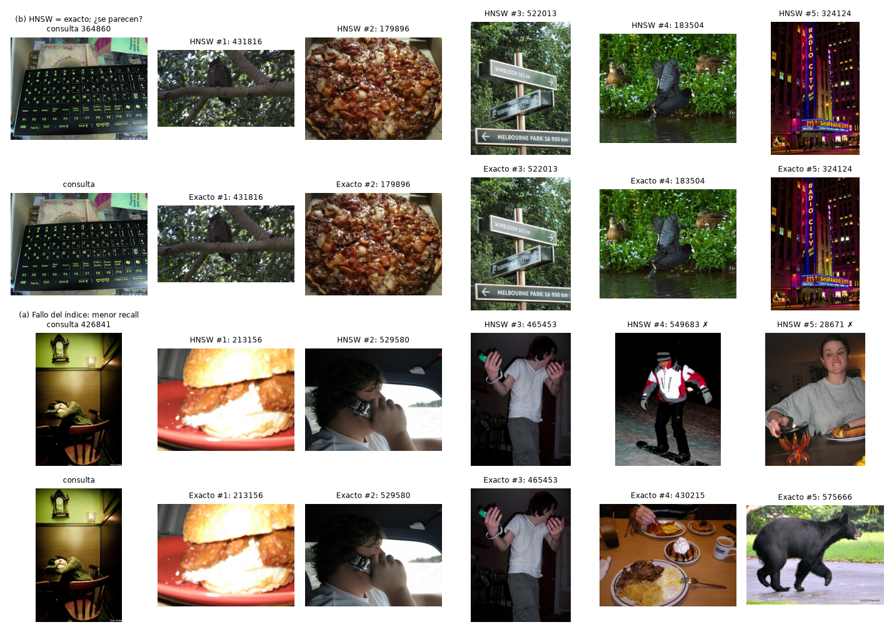

# Experimentos de la Parte 4: búsqueda multimedia

Comparación de **IVF frente a HNSW** y de **distancia euclidiana frente a
similitud del coseno** en búsquedas k-NN con k = 10 sobre 1 000, 10 000 y
100 000 imágenes reales (§2.4.4 del enunciado). Ambos índices son
implementación propia ([ivf.py](../engine/multimedia/ivf.py),
[hnsw.py](../engine/multimedia/hnsw.py)); la referencia es la búsqueda exacta
`VectorScan` sobre los mismos vectores.

Datos crudos: [benchmarks/results/multimedia/2026-11-06](../benchmarks/results/multimedia/2026-11-06/).
Tablas y figuras: [docs/figuras/multimedia](figuras/multimedia/). Evidencia de
cada fase: `PART_04/BLOQUE_6.md` (datos) y `PART_04/BLOQUE_7.md` (mediciones).

## 1. Datos y representación

- **Corpus:** COCO 2017 train, 100 000 imágenes de galería en subconjuntos
  anidados (1 000 ⊂ 10 000 ⊂ 100 000), 30 imágenes de consulta y 50 de ajuste,
  todas distintas por id y por bytes. Validación de datos: PASS
  ([multimedia_feasibility.json](implementacion/evidencias/multimedia/multimedia_feasibility.json)).
- **Vector de cada imagen:** hasta 256 descriptores SIFT (gris, lado mayor
  ≤ 512 px), vocabulario de 256 palabras visuales (K-Means entrenado una vez
  sobre el subconjunto de 1 000) e histograma TF-IDF de 256 dimensiones. El
  IDF se calcula para cada N. IVF y HNSW reciben exactamente los mismos
  vectores; la matriz de 100 000 × 256 float32 ocupa 97,7 MiB.
- **Audio:** se implementó y verificó con 30 canciones de FMA (ver §6); la
  curva de escala usa imágenes, como establece el plan (§2.8).

## 2. Protocolo

- **Configuraciones:** IVF y HNSW, cada uno con euclidiana y coseno: 4
  configuraciones × 3 tamaños × 30 consultas × 3 repeticiones = **1 080
  búsquedas cronometradas**, tras una pasada de calentamiento. El orden de
  las configuraciones rota en cada repetición.
- **Parámetros congelados antes de medir** (ajuste sobre las 50 imágenes de
  ajuste, nunca sobre las consultas finales):
  - IVF: `nlist = round(√N)` (32, 100 y 316 listas) y **`nprobe = 16`**, el
    único ajuste permitido por el plan (con 8 el recall de ajuste era 0,73).
  - HNSW: M = 16, M0 = 32, efConstruction = 100, **`efSearch = 64`**, ya
    sobre la meta de 0,90 en ajuste.
- **Fronteras:**
  - *Construcción:* desde vectores ya preparados hasta el índice cerrado,
    persistido y reabrible, en un proceso nuevo. La extracción de
    características es un costo común: no se carga a ningún índice.
  - *Consulta:* desde el vector de consulta hasta los ids y scores ordenados
    (enrutamiento o recorrido, puntuación exacta de candidatos, top-k). No
    incluye decodificar la imagen ni extraer SIFT.
  - *Memoria:* pico de RSS del proceso (VmHWM, reiniciado antes de cada fase)
    al construir, tras abrir el índice y durante las consultas.
- **Recall@10** = |top-10 del índice ∩ top-10 exacto| / 10, con el mismo
  orden score DESC, id ASC.
- **Máquina:** AMD Ryzen 7 250 (8 CPU lógicas), 7 GiB en WSL2, Python
  3.12.3, numpy 2.5.4. Una sola corrida: no hay intervalos de confianza.

## 3. Resultados

### Construcción



| N | IVF euclidiana | IVF coseno | HNSW euclidiana | HNSW coseno |
|---:|---:|---:|---:|---:|
| 1 000 | 0,14 s | 0,18 s | 4,8 s | 3,3 s |
| 10 000 | 4,0 s | 3,9 s | 59,1 s | 42,7 s |
| 100 000 | 61,2 s | 57,4 s | 708,6 s (11,8 min) | 496,0 s (8,3 min) |

IVF entrena nuestro K-Means sobre una muestra de hasta 50 000 vectores y
asigna cada vector a su lista. HNSW inserta los 100 000 elementos uno a uno
con búsquedas en el grafo, en Python: es entre 8 y 12 veces más lento de
construir a 100 000.

### Consulta



| N | IVF euclidiana | IVF coseno | HNSW euclidiana | HNSW coseno | VectorScan euclidiana | VectorScan coseno |
|---:|---:|---:|---:|---:|---:|---:|
| 1 000 | 1,95 ms | 0,27 ms | 1,12 ms | 0,92 ms | 3,49 ms | 0,27 ms |
| 10 000 | 4,73 ms | 0,85 ms | 1,61 ms | 1,30 ms | 11,6 ms | 3,21 ms |
| 100 000 | 8,18 ms | 3,66 ms | 1,94 ms | 1,73 ms | 73,1 ms | 29,9 ms |

Medias de 90 búsquedas; las medianas están en
[resumen_multimedia.csv](figuras/multimedia/resumen_multimedia.csv). Los
resultados son idénticos entre repeticiones.

- HNSW crece muy poco con N: de 0,9 a 1,7 ms en coseno (100 veces más datos).
  Evalúa ~1 600 vectores por consulta a 100 000.
- IVF evalúa todos los vectores de 16 listas (~5 700 a 100 000) y crece más.
- La búsqueda exacta crece linealmente: a 100 000 es 17–38 veces más lenta
  que HNSW.
- **Euclidiana frente a coseno en tiempo:** la diferencia viene de nuestra
  implementación, no de la métrica. La puntuación euclidiana materializa la
  resta de cada bloque de vectores (`x − q`), mientras que el coseno es un
  producto punto. Por eso VectorScan e IVF son 2–13 veces más lentos con
  euclidiana; en HNSW, donde se evalúan pocos vectores, la diferencia es
  pequeña.

### Precisión (Recall@10)



| N | IVF euclidiana | IVF coseno | HNSW euclidiana | HNSW coseno |
|---:|---:|---:|---:|---:|
| 1 000 | 0,970 | 0,990 | 0,997 | 1,000 |
| 10 000 | 0,867 | 0,917 | 0,927 | 0,927 |
| 100 000 | **0,723** | **0,800** | **0,683** | **0,693** |

El recall baja con N en ambos índices porque sus parámetros de búsqueda son
fijos:
- **IVF** sondea 16 listas, que son el 50 %, el 16 % y el 5 % del total a 1k,
  10k y 100k.
- **HNSW** explora 64 candidatos en la capa 0, pero entre 100 000 vectores
  los 10 vecinos exactos están muy juntos: en coseno, el 1.º y el 10.º
  difieren en promedio solo 0,026 de similitud.

No es un defecto del grafo: el 99,96 % de los nodos es alcanzable desde el
punto de entrada, hay 5 capas, y el recall sube al ensanchar la búsqueda.
Este barrido es un **diagnóstico posterior sobre las consultas finales**; no
cambia los parámetros medidos arriba
([diagnostic_search_width_100000.json](../benchmarks/results/multimedia/2026-11-06/diagnostic_search_width_100000.json)):

| N = 100 000 | Parámetro | Recall euclidiana | ms | Recall coseno | ms |
|---|---|---:|---:|---:|---:|
| HNSW | ef 64 / 128 / 256 / 512 | 0,68 / 0,83 / 0,92 / 0,97 | 2,2 / 4,6 / 10,8 / 16,9 | 0,69 / 0,82 / 0,92 / 0,97 | 1,7 / 3,0 / 5,5 / 9,7 |
| IVF | nprobe 16 / 32 / 64 / 128 | 0,72 / 0,86 / 0,93 / 0,96 | 8,8 / 14,6 / 23,2 / 41,1 | 0,80 / 0,91 / 0,98 / 1,00 | 3,5 / 6,4 / 14,0 / 31,1 |

Con recall comparable (~0,92), HNSW con coseno (ef 256, 5,5 ms) e IVF con
coseno (nprobe 32, 6,4 ms) cuestan algo parecido. Con euclidiana, HNSW
(ef 256, 10,8 ms) es el doble de rápido que IVF (nprobe 64, 23,2 ms).

### Memoria y disco



| N = 100 000 | IVF euclidiana | IVF coseno | HNSW euclidiana | HNSW coseno |
|---|---:|---:|---:|---:|
| Archivos del índice | 1,4 MiB | 1,4 MiB | 12,7 MiB | 12,7 MiB |
| Pico de RSS al construir | 658 MiB | 658 MiB | 580 MiB | 677 MiB |
| RSS con el índice abierto | 38 MiB | 38 MiB | 256 MiB | 256 MiB |
| Pico de RSS al consultar | 172 MiB | 158 MiB | 258 MiB | 258 MiB |

Los vectores (97,7 MiB) se guardan una sola vez en el almacén compartido y no
se cuentan en los archivos del índice.
- **IVF** guarda centroides y listas de filas, y solo lee los vectores de las
  listas sondeadas (memoria mapeada).
- **HNSW** guarda la adyacencia: 100 000 × 32 enlaces en la capa 0 más las
  capas superiores. Al abrirlo, carga en RAM una copia float32 de los
  vectores para recorrer el grafo, de ahí sus 256 MiB.

## 4. Galería de éxitos y errores



N = 100 000, HNSW con coseno. Cada caso muestra la fila de HNSW y, debajo, la
fila exacta; ✗ marca un vecino que HNSW no encontró.

- **(b) El índice acierta, la representación no.** Para la consulta 364860
  (un teclado), HNSW devuelve exactamente los 5 vecinos exactos (recall 1,0),
  pero son un búho, una pizza, letreros, patos y un edificio iluminado. La
  bolsa de palabras SIFT capta texturas y contrastes locales parecidos (bordes
  repetidos, patrones de alto contraste), no qué objeto aparece. Un recall
  perfecto no garantiza resultados que una persona considere parecidos.
- **(a) El índice falla.** Para la consulta 426841 (recall 0,4, el más bajo),
  HNSW comparte los 3 primeros vecinos con la búsqueda exacta, pero sus
  puestos 4 y 5 no están en el top exacto: el grafo dejó de explorar antes de
  alcanzarlos.
- **Éxito perceptual verificable:** el audio (§6), donde la consulta es otro
  fragmento de la misma canción.

## 5. Ventajas, desventajas y recomendaciones

| Aspecto | IVF (propio) | HNSW (propio) |
|---|---|---|
| Construcción a 100 000 | **~1 min** (K-Means + asignación) | 8–12 min (inserciones en Python) |
| Consulta a 100 000 con los parámetros congelados | 3,7–8,2 ms | **1,7–1,9 ms** |
| Crecimiento del tiempo de consulta con N | Lineal en los vectores de las listas sondeadas | Casi plano |
| Recall con los parámetros congelados a 100 000 | 0,72–0,80 | 0,68–0,69 |
| Recall ≥ 0,9 a 100 000 | nprobe 32 (coseno) o 64 (euclidiana): 6–23 ms | ef 256: 5–11 ms |
| Memoria con el índice abierto | **38 MiB** (vectores mapeados) | 256 MiB (copia de vectores + grafo) |
| Disco | **1,4 MiB** | 12,7 MiB |
| Exactitud alcanzable | `nprobe = nlist` da exactamente el resultado exacto (probado) | ef alto se acerca, sin garantía |

**Cuándo conviene cada uno:**
- **HNSW**, cuando importa la latencia de consulta y la colección cambia
  poco: construir es caro, pero cada consulta evalúa pocos vectores.
- **IVF**, cuando importan el tiempo de construcción, la memoria o poder
  subir `nprobe` hasta la respuesta exacta.
- **Coseno**, en esta representación: con IVF da mejor recall que la
  euclidiana con el mismo sondeo, y en nuestra implementación es más barato.
  Euclidiana y coseno ordenan distinto porque los vectores TF-IDF no se
  normalizan; con vectores unitarios ordenarían igual.
- **Para recall ≥ 0,9 a 100 000:** HNSW con ef ≈ 256 o IVF con nprobe 32–64.

## 6. Audio

Sobre la colección de demostración (30 fragmentos de 10 s de FMA, licencia CC
BY, vocabulario de 64 palabras de audio), cada consulta es **otro fragmento de
una canción de la galería** (segundos 15–25 frente a 0–10). En 4 de 5
consultas, la misma canción sale primera, y en la quinta sale segunda, igual
con IVF y HNSW y con euclidiana y coseno. El MP3 del ejemplo del enunciado
(`audio_query.mp3`) encuentra su canción en el primer puesto. En los archivos
sintéticos de prueba también apareció un fallo de representación: un acorde
más suave y con ruido queda más cerca de un barrido de frecuencias que de su
original.

## 7. Límites

- **Recall respecto de la búsqueda exacta.** Mide la aproximación del índice,
  no si una persona juzga parecidas las imágenes; la galería muestra que son
  cosas distintas.
- **Una sola corrida** en WSL2 con caché caliente: no hay intervalos de
  confianza. Las construcciones son una medición cada una.
- **Cambios de rendimiento de HNSW en la fase 4.** `keepPrunedConnections`
  duplica el tiempo de construcción a cambio de conectividad. El grafo del
  producto punto usa el espacio aumentado; no se escaló el producto punto,
  porque el enunciado no lo pide.
- **Copias JPEG.** Las imágenes se guardan como copias JPEG de ≤ 512 px. Las
  características de galería y consultas salen de esas copias, no de los
  originales de Flickr.
- **Python.** La construcción de HNSW en Python es el cuello de botella. No se
  usó ninguna librería de índices (FAISS, hnswlib) por regla del proyecto.

## 8. Reproducción

Ver [multimedia.md](multimedia.md#reproducir-el-experimento). Desde la raíz,
con Python 3.12 y el extra `multimedia`:

```bash
python -m benchmarks.multimedia.coco
python -m benchmarks.multimedia.features vocabulary
python -m benchmarks.multimedia.features counts
python -m benchmarks.multimedia.experiment run --nprobe 16
python -m benchmarks.multimedia.results --input benchmarks/results/multimedia/<fecha>
```
