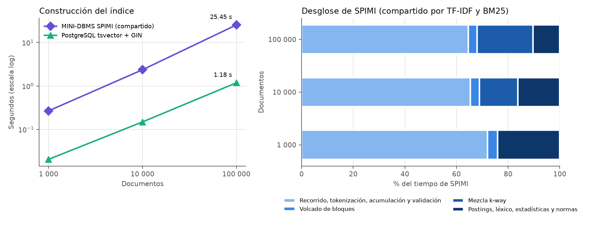
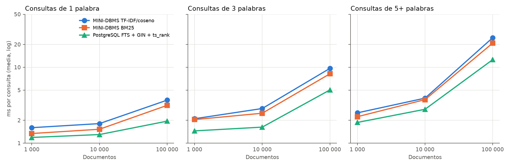
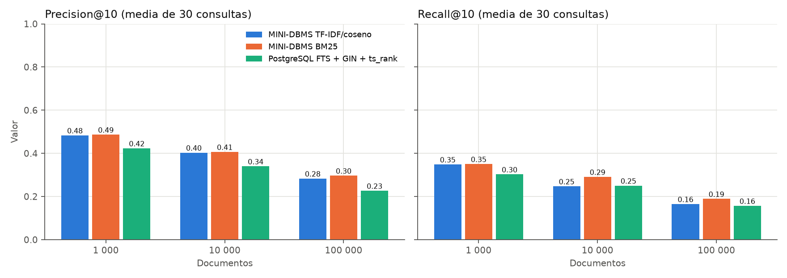
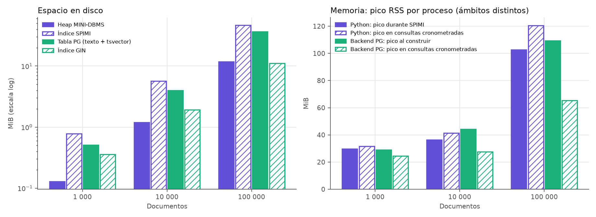

# Resultados experimentales de búsqueda textual

Datos y gráficos de la Parte 3, §2.3 del PDF (bloque 6 del
[plan](../PART_03/PLAN_PARTE_03.md)). Se comparan tres técnicas sobre el mismo
corpus, las mismas consultas y la misma semántica de coincidencia:

- **TF-IDF/coseno** sobre el índice SPIMI propio de MINI-DBMS;
- **BM25** sobre ese mismo índice SPIMI (k1 = 1,2; b = 0,75);
- **PostgreSQL FTS + GIN + `ts_rank`**, únicamente como comparador externo.

GIN es una estructura de acceso y `ts_rank` es la función de ranking nativa de
PostgreSQL; no equivale a BM25 ni al coseno propio.

## Archivos disponibles

- Figuras: [construcción](figuras/text/construccion.png),
  [consultas](figuras/text/consultas.png), [relevancia](figuras/text/relevancia.png)
  y [disco y memoria](figuras/text/recursos.png).
- Tablas: [tiempos de consulta](figuras/text/tiempos_consulta.csv),
  [relevancia por longitud](figuras/text/relevancia.csv),
  [construcción y recursos](figuras/text/construccion_y_recursos.csv) y
  [resumen completo](figuras/text/resumen.json), con el ranking top-10 por consulta.
- Datos originales: [benchmarks/results/text/2026-11-04](../benchmarks/results/text/2026-11-04/).
  Incluyen 810 tiempos medidos (`queries_*.jsonl`), las verificaciones
  semánticas, los 90 planes `EXPLAIN ANALYZE` de PostgreSQL, las mediciones de
  construcción y recursos, y `environment.json` con versiones, hashes del
  corpus y SHA-256 de cada archivo de código medido.

No se versionan el corpus completo, los Heap/índices generados ni la base
PostgreSQL; se reconstruyen con los comandos de [Reproducción](#reproducción).

## Corpus y consultas

Se usa el corpus aprobado en el [bloque 1B](../PART_03/BLOQUE_1B.md): títulos
íntegros de productos de Amazon ESCI (large_version/test/us), en subconjuntos
anidados de **1 000 ⊂ 10 000 ⊂ 100 000** documentos con semilla 20261024, y las
**30 consultas originales**: 10 de 1 palabra, 10 de 3 y 10 de 5 o más.

Para este experimento el corpus se regeneró desde las fuentes oficiales. Los
**13 artefactos coinciden byte a byte** con los hashes congelados en 1B
(documentos, consultas, qrels y manifiestos de los tres tamaños, más el
manifiesto global). La firma del tokenizador congelada usa Unicode 15.0.0, por
lo que toda la preparación y la medición se ejecutaron con CPython 3.12.3.
Con 3.11 (Unicode 14.0.0), documentos y qrels coinciden, pero difieren los
metadatos de la firma.

## Semántica común y verificación previa

Las tres técnicas usan la semántica OR de `MATCH`: un documento coincide si
contiene al menos un término normalizado de la consulta. Los términos se
obtienen con el tokenizador del motor (NFC, minúsculas, NFC y secuencias
máximas alfanuméricas), sin stemming ni stopwords.

**Diferencia encontrada en PostgreSQL y cómo se resolvió.** Con la
configuración `simple`, el parser de PostgreSQL descarta caracteres que
`str.isalnum()` acepta. En 5 de los 1 000 documentos, el término `½` existía
para el motor y no para PostgreSQL. Por eso a PostgreSQL no se le entrega el
texto para parsear. Se le entregan los tokens del motor en la sintaxis de
entrada de `tsvector` (`'término':posiciones`), que conserva términos y
frecuencias sin diccionarios. PostgreSQL sigue construyendo los valores
`tsvector`, el índice GIN y los scores `ts_rank`. La consulta es una `tsquery`
con el OR de los lexemas citados, pasada como parámetro tipado
(`EXECUTE ... USING`), nunca concatenada en la sentencia de búsqueda.

Antes de cronometrar, cada tamaño debe superar tres comprobaciones; si alguna
falla, el experimento se detiene sin medir:

| Comprobación | 1 000 | 10 000 | 100 000 |
|---|---|---|---|
| Lexemas y frecuencias por documento idénticos (firma de todos los documentos) | Igual | Igual | Igual |
| Conjunto completo de documentos coincidentes por consulta, motor frente a PostgreSQL (30 consultas) | 30/30 | 30/30 | 30/30 |
| Top-10 con índice SPIMI igual al scan exhaustivo, para TF-IDF y BM25 (IDs y scores) | 60/60 | 60/60 | 60/60 |

Planes reales de PostgreSQL, sin forzar el acceso:

| Documentos | Usa GIN (Bitmap Index Scan) | Seq Scan |
|---:|---:|---:|
| 1.000 | 11 | 19 |
| 10.000 | 29 | 1 |
| 100.000 | 30 | 0 |

Con 1 000 documentos el planificador prefiere recorrer la tabla en la mayoría
de las consultas. Se reporta tal cual; no se desactivó `enable_seqscan`.

## Protocolo

| Medida | Cómo se midió |
|---|---|
| Construcción | MINI-DBMS: `build_spimi` completo desde el Heap ya cargado (recorrido, tokenización, bloques, mezcla k-way, postings, léxico, estadísticas, normas TF-IDF, mapa ID/RID y validación índice/almacenamiento). Un solo índice sirve a TF-IDF y BM25: no se cuenta dos veces. PostgreSQL: construcción de `tsvector` + `CREATE INDEX ... USING gin`. Las demás etapas se reportan aparte. |
| Desglose | Cronómetros alrededor de las funciones internas de SPIMI, desde el proceso del benchmark; el motor no se modificó. |
| Consulta | Una pasada de calentamiento y 3 repeticiones de las 30 consultas, con el orden de los tres métodos rotado en cada consulta y repetición: 810 tiempos. Se reportan media y mediana. |
| Frontera temporal | MINI-DBMS: `SqlEngine.execute` (parse, bind, plan, `TextIndexScan`) hasta iterar el top-10 de IDs y scores, sin HTTP ni textos. PostgreSQL: ida y vuelta del cliente `psql` por `docker exec` hasta recibir el top-10 de IDs y `ts_rank`; incluye transporte local. El tiempo interno del servidor se guarda aparte. |
| Relevancia | Precision@10 y Recall@10 sobre los IDs del top-10, con los mismos qrels (grado > 0 es positivo; I/C/S/E → 0/1/2/3). Precision conserva denominador 10. Las 30 consultas tienen positivos en los tres tamaños. |
| Disco | Archivos del Heap y del índice; pico de temporales de SPIMI. En PostgreSQL: tabla (con TOAST), columnas `tsvector` y texto, GIN y clave primaria por separado. |
| Memoria | Pico RSS (`VmHWM`) de procesos aislados. Python: reiniciado justo antes de SPIMI y antes de las consultas cronometradas. PostgreSQL: backend de la sesión de construcción y de una sesión nueva usada solo para las consultas cronometradas. |

Entorno: WSL2 sobre Linux 6.18, AMD Ryzen 7 250 (8 CPU lógicas), 7,8 GiB de
RAM, CPython 3.12.3. PostgreSQL 17.11 en Docker (`postgres:17`, sin red,
límite de 2 GiB, `shared_buffers` = 128 MB, `work_mem` = 4 MB, sin
paralelismo ni JIT por sesión). Presupuesto de bloques SPIMI: 8 MiB, el valor
por defecto del owner. Caché caliente; cada proceso trabaja de forma secuencial.

## Resultados

### Construcción



| Documentos | SPIMI (MINI-DBMS) | PG: tsvector | PG: GIN | PG: tsvector + GIN |
|---:|---:|---:|---:|---:|
| 1.000 | 0,267 s | 0,009 s | 0,012 s | 0,020 s |
| 10.000 | 2,361 s | 0,050 s | 0,098 s | 0,148 s |
| 100.000 | 25,450 s | 0,505 s | 0,677 s | 1,182 s |

| Documentos | Bloques SPIMI | Pasadas de mezcla | Vocabulario | Postings | Recorrido, tokenización y validación | Volcado de bloques | Mezcla k-way | Postings, léxico, estadísticas y normas |
|---:|---:|---:|---:|---:|---:|---:|---:|---:|
| 1.000 | 1 | 0 | 5.113 | 16.548 | 0,193 s | 0,010 s | 0,000 s | 0,064 s |
| 10.000 | 6 | 1 | 22.535 | 158.769 | 1,544 s | 0,082 s | 0,352 s | 0,383 s |
| 100.000 | 59 | 2 | 80.467 | 1.579.657 | 16,447 s | 0,851 s | 5,504 s | 2,649 s |

Etapas fuera de la construcción, a 100 000 documentos: cargar el Heap,
26,471 s; sellar y publicar la colección, 9,781 s; reabrir y validar la
publicación, 5,121 s. En PostgreSQL: tokenizar en Python para preparar la carga,
2,295 s; `COPY`, 0,205 s; clave primaria, 0,039 s; `ANALYZE`, 0,097 s.

Las dos curvas crecen de forma casi lineal con N. SPIMI es unas 20 veces más
lento que PostgreSQL a 100 000. Dos tercios de su tiempo están en recorrer el
Heap, tokenizar en Python y validar el índice completo contra el
almacenamiento. Desde 10 000 documentos hay varios bloques y mezcla externa
real; a 100 000 son 59 bloques, 2 pasadas y hasta 16 runs abiertos.

### Consultas



Milisegundos por consulta (tiempo de cliente; PostgreSQL servidor = tiempo interno):

| Documentos | Longitud | TF-IDF media | TF-IDF mediana | BM25 media | BM25 mediana | PostgreSQL media | PostgreSQL mediana | PostgreSQL servidor |
|---:|---|---:|---:|---:|---:|---:|---:|---:|
| 1.000 | Todas | 2,067 | 2,012 | 1,870 | 1,851 | 1,503 | 1,412 | 0,448 |
| 10.000 | Todas | 2,861 | 2,743 | 2,581 | 2,441 | 1,904 | 1,670 | 0,801 |
| 100.000 | 1 | 3,685 | 1,675 | 3,146 | 1,808 | 1,947 | 1,305 | 0,822 |
| 100.000 | 3 | 9,666 | 5,749 | 8,200 | 5,191 | 5,023 | 3,878 | 3,615 |
| 100.000 | 5+ | 24,520 | 19,995 | 20,816 | 16,440 | 12,595 | 11,590 | 11,014 |
| 100.000 | Todas | 12,624 | 6,096 | 10,721 | 5,788 | 6,522 | 4,177 | 5,150 |

El detalle por longitud de los tres tamaños está en
[tiempos_consulta.csv](figuras/text/tiempos_consulta.csv).

El costo crece con el número de documentos que contienen algún término: la
semántica OR obliga a puntuar la unión de todas las listas de postings. Las
consultas de 5+ palabras suman más listas y términos frecuentes ("no",
"without", "for"). A 100 000 documentos son las más caras en los tres métodos.
BM25 resulta algo más rápido que TF-IDF en las medias. Una explicación
compatible es que no calcula la norma de la consulta ni divide por normas
documentales, pero no se perfiló por separado. PostgreSQL tiene los menores
tiempos; buena parte de su tiempo de cliente en consultas cortas es transporte
(`psql`/Docker): a 1 000 documentos el servidor usa 0,45 ms de 1,50 ms.

### Relevancia



| Documentos | TF-IDF P@10 | TF-IDF R@10 | BM25 P@10 | BM25 R@10 | PostgreSQL P@10 | PostgreSQL R@10 |
|---:|---:|---:|---:|---:|---:|---:|
| 1.000 | 0,483 | 0,349 | 0,487 | 0,350 | 0,423 | 0,303 |
| 10.000 | 0,403 | 0,247 | 0,407 | 0,291 | 0,340 | 0,250 |
| 100.000 | 0,283 | 0,165 | 0,297 | 0,189 | 0,227 | 0,157 |

Por longitud, a 100 000 documentos:

| Longitud | TF-IDF P@10 | TF-IDF R@10 | BM25 P@10 | BM25 R@10 | PostgreSQL P@10 | PostgreSQL R@10 |
|---|---:|---:|---:|---:|---:|---:|
| 1 | 0,310 | 0,195 | 0,280 | 0,176 | 0,280 | 0,176 |
| 3 | 0,190 | 0,156 | 0,240 | 0,228 | 0,140 | 0,163 |
| 5+ | 0,350 | 0,144 | 0,370 | 0,162 | 0,260 | 0,132 |

BM25 obtiene la mayor media de P@10 y R@10 en los tres tamaños, aunque con
diferencias pequeñas frente a TF-IDF; en las consultas de una palabra a
100 000, TF-IDF acierta más (0,310 frente a 0,280). TF-IDF y BM25 producen un top-10 con distinto orden en 24,
24 y 25 de las 30 consultas, y con distinto conjunto en 16, 22 y 25. PostgreSQL
con `ts_rank` (normalización 0) queda por debajo en los tres tamaños: su score
cuenta apariciones de los lexemas, sin IDF, de modo que un término muy
frecuente pesa tanto como uno raro. La relevancia baja al crecer el corpus
porque se agregan distractores que compiten por el top-10.

### Disco y memoria



| Documentos | Heap MINI-DBMS | Índice SPIMI | Temporales SPIMI máx. | Tabla PG (con TOAST) | Columna `tsvector` | GIN | Clave primaria PG |
|---:|---:|---:|---:|---:|---:|---:|---:|
| 1.000 | 0,13 MiB | 0,78 MiB | 0,34 MiB | 0,51 MiB | 0,22 MiB | 0,36 MiB | 0,04 MiB |
| 10.000 | 1,20 MiB | 5,70 MiB | 6,04 MiB | 4,01 MiB | 2,14 MiB | 1,93 MiB | 0,23 MiB |
| 100.000 | 11,82 MiB | 46,48 MiB | 52,25 MiB | 36,51 MiB | 21,31 MiB | 11,05 MiB | 2,16 MiB |

A 100 000 documentos, el índice SPIMI ocupa 24,10 MiB de postings (unos 16
bytes por posting), 6,01 MiB de léxico y 16,36 MiB del archivo de documentos.
Este último es JSON por líneas con ID, RID, longitud, norma y hash de cada
fila. La representación equivalente en PostgreSQL es la columna `tsvector`
más el GIN: 32,36 MiB.

| Documentos | Python: pico en SPIMI | Python tras abrir la colección | Python: pico en consultas | Backend PG: pico al construir | Backend PG: pico en consultas |
|---:|---:|---:|---:|---:|---:|
| 1.000 | 29,6 MiB | 28,4 MiB | 31,6 MiB | 28,9 MiB | 24,4 MiB |
| 10.000 | 36,4 MiB | 35,9 MiB | 41,3 MiB | 44,3 MiB | 27,5 MiB |
| 100.000 | 102,8 MiB | 88,9 MiB | 120,4 MiB | 109,4 MiB | 65,3 MiB |

Los bloques SPIMI respetan el presupuesto de 8 MiB. El crecimiento del pico
con N viene de los metadatos por documento (ID, RID, longitud y hash), que son
O(N) y quedan fuera de ese presupuesto: el reporte del constructor los estima
en 47,6 MiB a 100 000. Abrir la colección deja el léxico y las estadísticas en
memoria (88,9 MiB de RSS). Las consultas cronometradas no elevaron el pico:
los 120,4 MiB ya estaban al empezar, retenidos por el asignador de Python
tras la verificación previa. Los ámbitos no son comparables entre sí: el
backend PostgreSQL excluye el cliente, Docker y los demás procesos del
servidor, e incluye páginas compartidas que haya tocado.

## Revisión manual de resultados

Dos consultas a 100 000 documentos ilustran por qué las cifras deben leerse
con cuidado. No se cambió ninguna etiqueta.

- **`0.7 pens`** se tokeniza como `0`, `7` y `pens`. BM25 (P@10 = 0,4) y
  PostgreSQL (0,3) recuperan bolígrafos PILOT y Pentel de 0,7 mm juzgados como
  positivos. TF-IDF (0,2) pone en tercer lugar un producto cuyo título es
  solo `0`. El coseno divide por la norma de todo el documento, así que un
  título de un solo término que coincide obtiene un score alto. El primer
  resultado de los tres métodos ("24 Pieces Retractable Ballpoint Pens… 0.7 mm")
  parece relevante pero **no tiene juicio**: cuenta como no relevante. Esto
  subestima P@10 en los tres métodos por igual.
- **`0w20 synthetic oil`**: TF-IDF (0,3) supera a BM25 y PostgreSQL (0,1). En
  los primeros puestos de BM25 y PostgreSQL aparecen aceites 75W90 o 20W50 con
  `synthetic` y `oil` en el título (en algunos, `oil` dos veces). Ningún método
  exige que aparezca `0w20`, porque la semántica es OR. Un solo término raro
  no garantiza el primer puesto.

## Ventajas, desventajas y cuándo usar cada opción

| Técnica | Ventajas observadas | Desventajas observadas | Cuándo conviene |
|---|---|---|---|
| TF-IDF/coseno (SPIMI propio) | Comparte el índice con BM25. Relevancia cercana a BM25 y mejor en las consultas de una palabra a 100 000 (P@10 0,31). Ranking explicable: pesos por término y normalización vectorial. | La norma del documento completo favorece títulos muy cortos que coinciden con un término frecuente. Es la opción más lenta en consultas largas (24,5 ms de media en 5+ palabras a 100 000). Construcción en Python: 25,5 s a 100 000. | Consultas cortas y colecciones de longitud homogénea, cuando interesa la similitud entre vectores más que la frecuencia absoluta. |
| BM25 (SPIMI propio) | Mayor P@10 y R@10 medios en los tres tamaños. Algo más rápido que TF-IDF. La saturación de tf (k1) evita que un término repetido domine y la normalización por longitud (b) compensa títulos largos. | Misma construcción y mismo disco que TF-IDF. Ganancias pequeñas en este corpus. La normalización por longitud puede premiar títulos cortos incompletos. k1 y b fijos, sin ajuste. | Opción por defecto para relevancia en este tipo de corpus; consultas de varias palabras. |
| PostgreSQL FTS + GIN + `ts_rank` | Construcción unas 20 veces más rápida (1,18 s frente a 25,45 s a 100 000) y consultas más rápidas (6,5 ms frente a 10,7–12,6 ms). GIN más compacto que los postings SPIMI. Sistema maduro y transaccional. | Menor P@10 y R@10 en los tres tamaños con `ts_rank` (normalización 0, sin IDF). Su parser propio no coincide con el tokenizador del motor (`½`). Con 1 000 documentos elige Seq Scan en 19 de 30 consultas. | Cuando importan el tiempo de construcción y de respuesta y un sistema operado, aceptando un ranking más simple. |

La estructura de índice y la función de ranking son decisiones distintas.
TF-IDF y BM25 usan el mismo índice invertido y difieren solo en la fórmula.
GIN también es un índice invertido; la diferencia de relevancia viene de
`ts_rank`, no de GIN.

## Límites de la evaluación

- Los juicios ESCI son finitos y por producto: un documento sin juicio cuenta
  como no relevante aunque lo sea. P@10 y R@10 son **respecto de los juicios
  disponibles**, no exhaustividad semántica.
- El corpus es una selección enriquecida en positivos (todos los positivos
  están ya en 1 000 documentos), no el benchmark ESCI completo.
- Una sola matriz con 3 repeticiones, en una máquina WSL2 con caché caliente
  y poca memoria libre: no hay intervalos de confianza ni se extrapola a otras
  máquinas.
- Los tiempos de PostgreSQL incluyen transporte local por `psql`/Docker; el
  motor propio se mide dentro del proceso Python. Por eso se guarda también el
  tiempo interno del servidor.
- No se exploraron otras normalizaciones de `ts_rank`, `ts_rank_cd` ni ajustes
  de k1/b: el plan no los exige y no se presentan como medidos.
- RSS no equivale a la memoria exclusiva de un índice; cada cifra declara qué
  proceso se midió.

## Reproducción

Requiere Docker y Python con Unicode 15.0.0 (CPython 3.12), desde la raíz:

```bash
python3.12 -m venv .venv312
.venv312/bin/python -m pip install -e ".[test,api,bench,corpus]"

# 1. Regenerar el corpus congelado (descarga verificada de ESCI, ~1,16 GB).
B=data/generated/text_corpus/esci_us_test
P=".venv312/bin/python scripts/prepare_text_corpus.py"
$P download-esci --source-dir $B/sources --metadata-only
$P preflight --source-dir $B/sources --output-dir $B/preparation_py312
$P download-esci --source-dir $B/sources
$P validate --source-dir $B/sources --output-dir $B/preparation_py312
$P select --source-dir $B/sources --output-dir $B/preparation_py312
$P subsets --source-dir $B/sources --preparation-dir $B/preparation_py312 \
    --output-dir $B/accepted_py312 --seed 20261024

# 2. Ejecutar la matriz en directorios NUEVOS (arranca su propio contenedor).
.venv312/bin/python -m benchmarks.text.experiment run --corpus $B/accepted_py312 \
    --output benchmarks/results/text/<nueva> --work data/generated/text_bench/<nueva> \
    --container minidbms-text-pg --start-container

# 3. Regenerar tablas y figuras desde los datos conservados, sin medir.
.venv312/bin/python -m benchmarks.text.results \
    --input benchmarks/results/text/2026-11-04 --output docs/figuras/text
```

Compruebe que los archivos de `accepted_py312` coinciden con los SHA-256 de
[text_1b_closure](implementacion/evidencias/text_1b_closure/) antes de medir.
El contenedor `minidbms-text-pg` debe no existir; al terminar se elimina con
`docker rm -f minidbms-text-pg`.
