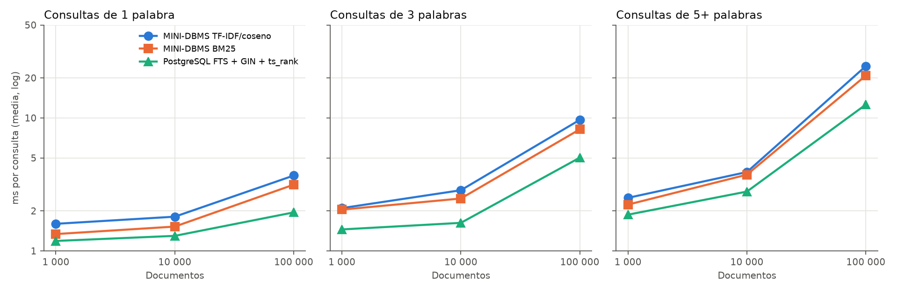
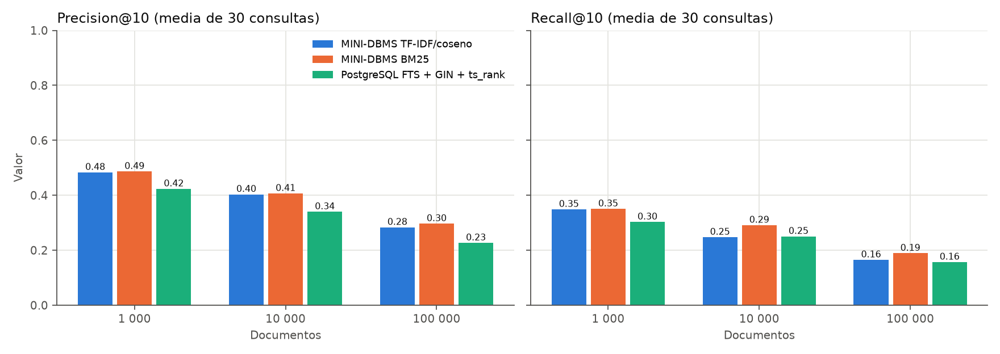

# Parte 3: búsqueda textual

Sección del informe incremental para la Parte 3 del proyecto (§2.3 del PDF).
Resume el diseño implementado y los resultados medidos; las cifras completas,
la metodología y los límites están en
[EXPERIMENTOS_TEXTO.md](../EXPERIMENTOS_TEXTO.md).

## 1. Problema y alcance

La Parte 3 incorpora recuperación de documentos por relevancia: dada una
consulta en lenguaje natural, devolver los documentos más parecidos ordenados
por un score. Se implementaron un índice invertido construido con SPIMI y dos
funciones de ranking, TF-IDF con similitud del coseno y BM25, integrados en el
motor SQL propio. Se compararon con PostgreSQL (FTS + GIN + `ts_rank`).

No se usan embeddings, bases vectoriales externas ni frameworks de
recuperación: los "vectores" son los pesos por término de cada documento,
guardados de forma dispersa.

## 2. Representación e índice invertido SPIMI

Cada término distinto del vocabulario es una dimensión. Un documento se
representa por las frecuencias `tf(t, d)` de los términos que contiene; los
ausentes valen cero y no se guardan. El índice invertido agrupa esas
componentes por término: para cada término, la lista de postings
`(doc_id, tf)`.

El tokenizador es el mismo para documentos y consultas: normalización NFC,
minúsculas, NFC otra vez y secuencias máximas de caracteres alfanuméricos.
No hay stemming ni stopwords.

La construcción sigue SPIMI (*Single-Pass In-Memory Indexing*):

1. Se recorre el Heap una vez. Por cada documento se cuentan sus términos y se
   agregan los postings a un diccionario `término → postings` en memoria.
2. Cuando el bloque alcanza el presupuesto de memoria (8 MiB por defecto), se
   ordenan sus términos y los postings de cada término por `doc_id`, y se
   escribe el bloque a disco.
3. Los bloques se mezclan con *k-way merge* y fan-in limitado (16), en varias
   pasadas si hace falta; las listas de un mismo término se mezclan en orden.
4. Se escriben los postings definitivos, el léxico (término, dimensión,
   offset, `df`), las estadísticas (N, longitud media) y, para cada
   documento, su RID, longitud y norma TF-IDF.

Con 100 000 títulos se generaron 59 bloques y 2 pasadas de mezcla. Al consultar
no se cargan todos los postings: el léxico y las estadísticas quedan en
memoria y cada lista se lee por offset con buffers acotados.

## 3. Ranking

Ambas fórmulas se aplican sobre el mismo índice; la consulta usa semántica OR
(basta un término en común).

**TF-IDF y coseno**

```text
w(t,d) = (1 + ln tf(t,d)) · (ln((N + 1)/(df(t) + 1)) + 1)
score(d,q) = Σ_t w(t,d) · w(t,q) / (‖d‖ · ‖q‖)
```

La norma de cada documento se calcula sobre todo su vector durante la
construcción.

**BM25** (k1 = 1,2; b = 0,75)

```text
idf(t) = ln(1 + (N − df(t) + 0,5)/(df(t) + 0,5))
score(d,q) = Σ_t idf(t) · tf(t,d)·(k1 + 1) / (tf(t,d) + k1·(1 − b + b·|d|/avgdl))
```

k1 satura el aporte de un término repetido y b normaliza por la longitud del
documento. Con `LIMIT k` y orden por score descendente se usa un heap de
tamaño k; para los demás órdenes se ordenan todas las coincidencias con
`ExternalSort` antes de limitar.

## 4. Integración con SQL, transacciones e interfaz

El parser escrito a mano reconoce `MATCH(campo, consulta)`, `USING TF_IDF` o
`USING BM25`, `SCORE()` con alias, `ORDER BY` y `LIMIT`:

```sql
SELECT * FROM documentos
WHERE MATCH(contenido, 'base de datos vectorial')
USING TF_IDF LIMIT 10;

SELECT *, SCORE() AS relevancia FROM articulos
WHERE MATCH(texto, 'machine learning')
USING BM25 ORDER BY relevancia DESC;
```

El planificador elige `TextIndexScan` (postings) o `TextScan` (recorrido del
Heap con las mismas fórmulas, para verificar). El plan real se muestra en la
interfaz.

La colección se publica de forma inmutable: tras construir el índice, el Heap
queda sellado y el motor rechaza INSERT/DELETE sobre ella antes de capturar
undo. Así el índice nunca queda desactualizado respecto de los datos.

## 5. Evaluación experimental

Se usaron títulos de productos de Amazon ESCI en subconjuntos anidados de
1 000, 10 000 y 100 000 documentos, con 30 consultas originales (10 de 1
palabra, 10 de 3 y 10 de 5 o más) y sus juicios de relevancia. Antes de medir
se verificó, para cada tamaño, que el motor y PostgreSQL indexan los mismos
lexemas con las mismas frecuencias y que encuentran exactamente los mismos
documentos en las 30 consultas.

Resultados a 100 000 documentos:

| Técnica | Construcción | Consulta (media / mediana) | P@10 | R@10 |
|---|---:|---:|---:|---:|
| TF-IDF/coseno (SPIMI propio) | 25,45 s (índice compartido) | 12,62 / 6,10 ms | 0,283 | 0,165 |
| BM25 (SPIMI propio) | 25,45 s (índice compartido) | 10,72 / 5,79 ms | 0,297 | 0,189 |
| PostgreSQL FTS + GIN + `ts_rank` | 1,18 s | 6,52 / 4,18 ms | 0,227 | 0,157 |





## 6. Conclusiones

- **Relevancia:** BM25 obtuvo la mejor P@10 y R@10 media en los tres tamaños,
  con ventajas pequeñas sobre TF-IDF; en consultas de una palabra a 100 000,
  TF-IDF fue mejor. `ts_rank` quedó por debajo en los tres tamaños: cuenta
  apariciones de términos sin IDF.
- **Tiempo:** PostgreSQL construye unas 20 veces más rápido y, en media,
  responde entre 1,6 y 1,9 veces más rápido que BM25 y TF-IDF, aun incluyendo
  su transporte local: es un sistema optimizado en C.
  Nuestro índice paga la tokenización en Python y una validación completa
  del índice contra el almacenamiento.
- **Longitud de la consulta:** con semántica OR, cada término agrega una lista
  de postings que hay que puntuar. Las consultas de 5+ palabras son las más
  costosas en los tres métodos (a 100 000, 24,5 ms con TF-IDF frente a 3,7 ms
  con una palabra).
- **Estructura frente a fórmula:** GIN y SPIMI son índices invertidos; las
  diferencias de relevancia vienen de la función de ranking, no del índice.

Las métricas se calculan respecto de juicios incompletos: un documento sin
juicio cuenta como no relevante. La revisión manual de
[EXPERIMENTOS_TEXTO.md](../EXPERIMENTOS_TEXTO.md) muestra un caso así.
