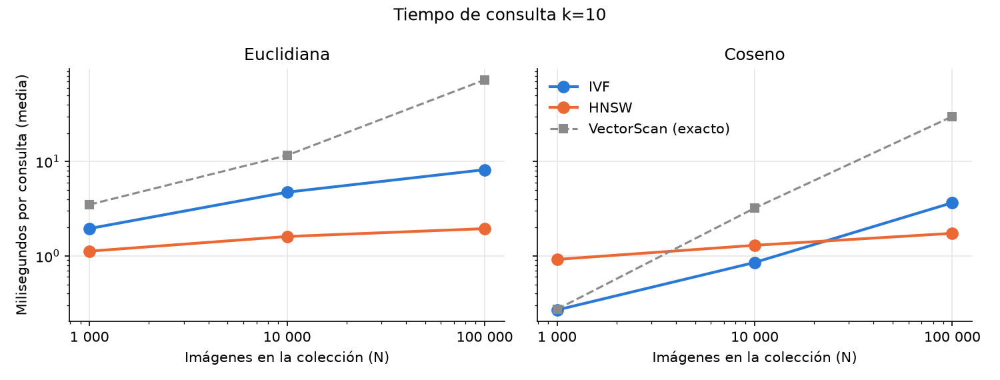
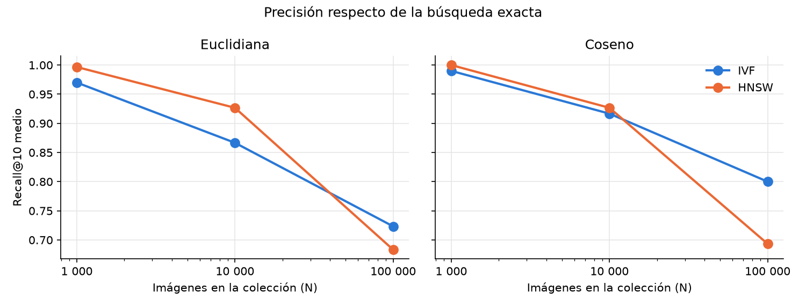
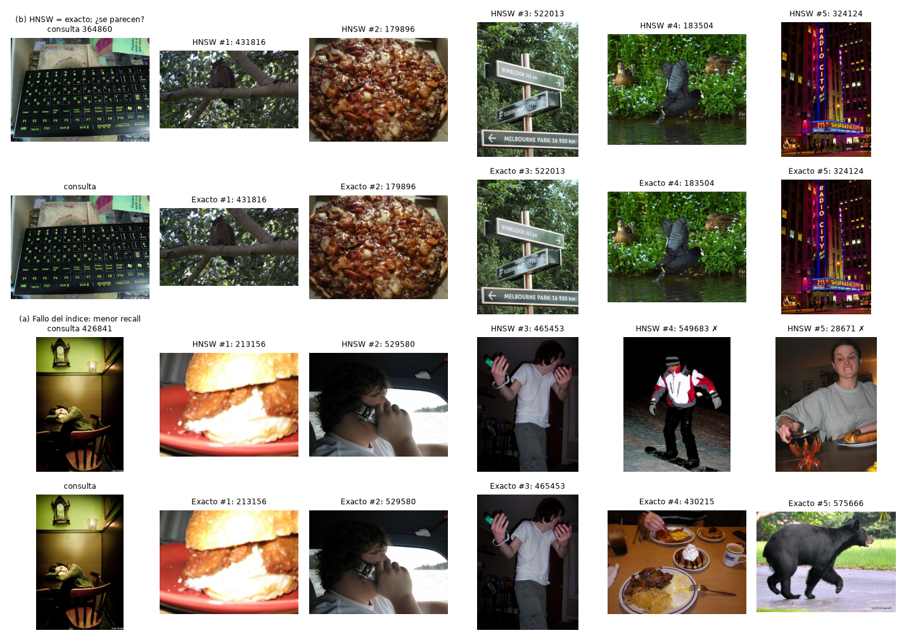

# Parte 4: búsqueda multimedia

Sección del informe incremental para la Parte 4 del proyecto (§2.4 del PDF).
Resume el diseño implementado y los resultados medidos; las cifras completas,
el protocolo y los límites están en
[EXPERIMENTOS_MULTIMEDIA.md](../EXPERIMENTOS_MULTIMEDIA.md).

## 1. Problema y alcance

Dada una imagen o un audio de consulta, el motor devuelve los k objetos más
parecidos de una colección. El enunciado pide imágenes **y** audio: ambos
tienen su extracción de características, sus índices y su sintaxis SQL. La
curva de escala (1 000, 10 000 y 100 000 objetos) se midió con imágenes; el
audio se verificó con una colección funcional de 30 canciones reales.

Usamos librerías solo para decodificar archivos, extraer SIFT y MFCC y
entrenar el vocabulario. Son nuestros: la bolsa de palabras y el TF-IDF, las
tres métricas, la búsqueda exacta, IVF con su K-Means, HNSW, la persistencia y
toda la integración con SQL, la API y la interfaz. No se usan FAISS, hnswlib
ni bases vectoriales, y una prueba de arquitectura lo hace cumplir.

## 2. ExtractFeatures

1. **Patrones locales.**
   - Imágenes: escala de grises, lado mayor ≤ 512 px, y los 256 puntos SIFT
     de mayor respuesta (vectores de 128 dimensiones).
   - Audio: mono a 22 050 Hz y MFCC de 20 coeficientes por ventana (FFT
     2 048, salto 512), con los parámetros del espectrograma mel fijados
     explícitamente.
2. **Cuantización.** K-Means sobre una muestra de hasta 100 000 descriptores,
   con semilla. Cada centroide es una "palabra": 256 visuales y 64 de audio.
3. **Histograma y TF-IDF.** Cada descriptor se asigna a su palabra más
   cercana; con los conteos `h_j` se calcula:

```text
tf_j = 1 + ln(h_j)  si h_j > 0;  idf_j = ln((N + 1)/(df_j + 1)) + 1;  x_j = tf_j · idf_j
```

`df` cuenta objetos, no descriptores. Las consultas usan el vocabulario y el
IDF de la galería, sin modificarlos. Los objetos sin descriptores (imagen
lisa, silencio) o los archivos ilegibles se rechazan con un motivo explícito;
nunca se inventa un vector.

## 3. Métricas y score

| Métrica | `SIMILARITY_SCORE()` | Orden |
|---|---|---|
| Euclidiana | −distancia | score DESC, id ASC |
| Producto punto | x · q | score DESC, id ASC |
| Coseno | x·q / (‖x‖‖q‖) | score DESC, id ASC |

Un score mayor siempre es mejor, por eso el segundo ejemplo del PDF (`ORDER BY
score DESC` con euclidiana) devuelve primero el más cercano. Los vectores se
guardan sin normalizar: con vectores unitarios, euclidiana y coseno
ordenarían exactamente igual y la comparación pedida perdería sentido.

## 4. Índices

- **Búsqueda exacta (`VectorScan`).** Puntúa todos los vectores por bloques y
  conserva los k mejores. Es la referencia del Recall@10 y lo que se ejecuta
  al desmarcar «Usar índices».
- **IVF.**
  - Nuestro K-Means (k-means++, Lloyd, mejor de 3 reinicios) agrupa los
    vectores en `nlist = √N` listas: una partición para euclidiana y producto
    punto, y otra sobre vectores normalizados para coseno.
  - Una consulta ordena las listas según su métrica, sondea `nprobe` y
    puntúa exactamente sus vectores.
  - Sondeando todas las listas, el resultado es idéntico bit a bit al de la
    búsqueda exacta (probado).
- **HNSW** (Malkov y Yashunin):
  - grafo de varias capas con niveles aleatorios y semilla;
  - inserción con `efConstruction = 100` y la heurística de selección de
    vecinos (con *keepPrunedConnections*);
  - enlaces recíprocos con poda, M = 16 y 32 en la capa 0;
  - búsqueda voraz en las capas altas y `efSearch = max(64, k)` en la capa 0;
  - los candidatos se repuntúan exactamente;
  - para el producto punto, el grafo se construye sobre vectores aumentados
    con `√(M² − ‖x‖²)`, donde el orden euclidiano coincide con el del
    producto punto.

Todo se escribe una vez en un directorio nuevo, con sumas de verificación, y
se reabre sin reentrenar ni reconstruir.

## 5. Integración

```sql
SELECT * FROM imagenes WHERE SIMILAR_TO('foto_consulta.jpg', k=10)
USING HNSW WITH METRIC=cosine;

SELECT nombre, artista, SIMILARITY_SCORE() AS score FROM canciones
WHERE SIMILAR_TO('audio_query.mp3', k=5) USING IVF WITH METRIC=euclidean
ORDER BY score DESC;
```

- **SQL.** El parser escrito a mano reconoce `SIMILAR_TO`, `USING ... WITH
  METRIC` y `SIMILARITY_SCORE()`. El binder valida el subconjunto: una tabla,
  orden solo por mejor score, `LIMIT` después de k, y el archivo de la
  modalidad correcta.
- **Ejecución.** El planificador produce `VectorIndexScan` o `VectorScan`, y
  `EXPLAIN ANALYZE` muestra el método pedido y el ejecutado, los vectores
  evaluados, `nprobe` o `efSearch`, y los tiempos de extracción y de búsqueda.
- **Inmutabilidad.** Como en la Parte 3, la colección se publica sellada: el
  motor rechaza INSERT y DELETE antes de cualquier efecto, incluso con
  `--allow-writes`.
- **Interfaz.** Muestra miniaturas, reproductores de audio y el significado
  del score.

## 6. Evaluación experimental

Se usaron 100 000 imágenes de COCO 2017 (subconjuntos anidados de 1 000 y
10 000), 30 consultas y 50 imágenes de ajuste, y 1 080 búsquedas
cronometradas. Los parámetros se congelaron antes de medir: IVF con
`nprobe = 16` y HNSW con `efSearch = 64`.

| N = 100 000 | IVF euclid. | IVF coseno | HNSW euclid. | HNSW coseno | Exacta euclid. / coseno |
|---|---:|---:|---:|---:|---:|
| Construcción | 61 s | 57 s | 709 s | 496 s | — |
| Consulta (media) | 8,2 ms | 3,7 ms | 1,9 ms | 1,7 ms | 73,1 / 29,9 ms |
| Recall@10 | 0,72 | 0,80 | 0,68 | 0,69 | 1 |
| Índice en disco | 1,4 MiB | 1,4 MiB | 12,7 MiB | 12,7 MiB | — |





## 7. Conclusiones

- **Velocidad.** HNSW responde en ~2 ms casi sin importar N: evalúa unos
  1 600 de 100 000 vectores. IVF crece con los vectores de las listas
  sondeadas, y la búsqueda exacta es lineal (17–38 veces más lenta que HNSW a
  100 000).
- **Construcción.** IVF construye en ~1 minuto; HNSW tarda de 8 a 12 minutos
  en Python, porque inserta elemento por elemento.
- **Precisión.** Con parámetros fijos, el recall cae al crecer N en ambos
  índices. A 100 000 vectores de 256 dimensiones, los vecinos exactos están
  muy juntos, así que hace falta buscar más ancho. Con HNSW ef = 256 o IVF
  nprobe = 32–64 el recall supera 0,92, a cambio de 5–23 ms por consulta
  (diagnóstico posterior que no cambia la medición reportada).
- **Métrica.** El coseno dio mejor recall que la euclidiana en IVF con el
  mismo sondeo, y en nuestra implementación es más barato de calcular.
- **Representación.** Un recall perfecto no garantiza resultados que una
  persona considere parecidos: la galería muestra un teclado cuyos vecinos
  exactos son un búho, una pizza y unos letreros. La bolsa de palabras SIFT
  capta texturas locales, no objetos. En audio, la misma representación sí
  reconoce otro fragmento de la misma canción en 4 de 5 consultas.


